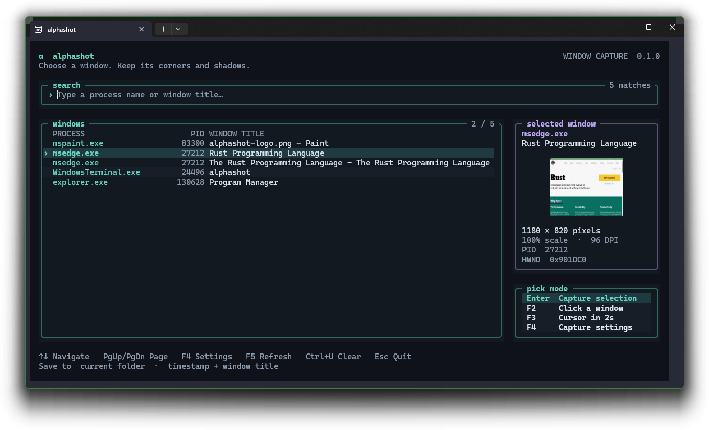

<p align="center">
  
</p>

<h1 align="center">alphashot</h1>

<p align="center">
  Window screenshots for Windows 10 and 11 with a transparent background, rounded corners and the DWM shadow.
</p>

<p align="center">
  
</p>

By default, alphashot captures a single window over a white and a black backdrop and solves
for per-pixel alpha. The default output has straight alpha: the frame corners are cut
out and the shadow is semi-transparent, so the image composites onto any
background. The screenshot above shows alphashot capturing its own picker.

## Install

```powershell
cargo install alphashot --locked
```

Building requires Rust 1.88 or newer with the MSVC toolchain (Visual Studio C++
build tools and a Windows SDK). The backdrop backend requires Windows 10 1903
or later; WGC and picker thumbnails require Windows 10 2004 (build 19041) or
later. Capture requires an interactive desktop.

Prebuilt x86_64 binaries are on the
[releases page](https://github.com/Sofahamster/alphashot/releases). The
executable is unsigned, so SmartScreen may warn on first launch.

## Usage

Run `alphashot` from a terminal. The picker lists top-level windows; type to
fuzzy-filter by process name or title (`ntpd` matches `notepad.exe`) and press
Enter. The backdrops flash behind the window for a second or two, so keep the
window still until the capture finishes. Alphashot writes
`YYYY-MM-DD-HH-MM-SS-<title>.png` to the current directory and refuses to
replace an existing file without `--force`.

Each capture also copies the transparent image and the saved file to the Windows
clipboard. Paste directly into an image editor, chat or Explorer; the receiving
app chooses the format. Use `--no-clipboard` to keep the current clipboard.

| Key | Action |
| --- | --- |
| Enter, double-click | Capture the selected window |
| F2 | Pick by clicking a window |
| F3 | Pick the window under the cursor after `--pick-delay` seconds (default 2) |
| F4, Tab | Capture settings: format, focus state, cursor, alpha mode, scale, presets, backend, shadow, TIFF alpha |
| F5 | Refresh windows and thumbnails |
| Ctrl+U | Clear the search |
| Esc, Ctrl+C | Quit |

In Windows Terminal 1.22 or newer, or another terminal with Sixel support, the
picker shows a thumbnail of the selected window, and the summary after a capture
shows the result.

```powershell
# Capture by title or handle without the picker.
alphashot --window-title "Notepad" -o notepad.png
alphashot --window-hwnd 0x123456 -o window.webp

# Wait for a window, combining case-insensitive selectors.
alphashot --process notepad.exe --window-title "notes" --wait 10 -o notes.png

# Select once; Enter captures another change, q or Esc ends the session.
alphashot --repeat --window-title "Notepad" -o notes.png

# Click a window, then open a menu within four seconds.
alphashot --pick-mode overlay --post-pick-delay 4

# Unfocused appearance with the mouse cursor.
alphashot --window-title "Notepad" --focus-state unfocused --include-cursor

# Keep the current appearance without activating the target.
alphashot --window-title "Notepad" --backend wgc

# Standard native frames use a feathered approximation for rounded corners.
# Request removal of the DWM shadow while retaining the frame and alpha.
alphashot --window-title "Notepad" --no-shadow

# Render on a display scaled above 100% (see docs/high-dpi.md).
alphashot --window-title "Notepad" --high-dpi
```

Output formats are PNG, lossless WebP and TIFF. With stdout redirected,
alphashot prints the saved paths and nothing else; exit codes are 0 for
success, 1 for errors or cancellation and 2 for invalid arguments.
`alphashot --list-windows` prints window handles as tab-separated values for
scripts, and `--window-hwnd` then captures without the picker.
`--process` matches an exact executable basename, `--window-class` an exact
Win32 class, and `--window-title` a title substring; selectors combine with AND.
`--wait` waits up to 3600 seconds for a selector match without resolving
ambiguity. The window listing includes the class name for discovery.
`--list-displays` lists display names for `--high-dpi-display`. See
`alphashot --help` for all options.

For high-DPI capture without a scaled physical monitor, see the
[virtual display setup](docs/high-dpi.md#set-up-a-virtual-display): install
Virtual Display Driver from an administrator terminal, extend the desktop to
the virtual monitor, and set its scale to 200%.

Save capture defaults with `--save-preset NAME` and reuse them with
`--preset NAME` or the picker's F4 settings. Presets include the output folder
(`--out-dir`), format, TIFF alpha, cursor, focus, backend, shadow, margins and
DPI selection; explicit CLI options take precedence. See
[saved presets](docs/usage.md#saved-presets).

The default `--backend backdrop` recovers alpha over white and black backgrounds.
`--backend wgc` preserves native alpha and the current appearance without
activation. It omits the outer DWM shadow but can retain shadow in rounded
corners. `--no-shadow` crops to the frame and uses an approximate one-pixel
feather to clear standard DWM corner shadows. It selects square, 4-DIP or
8-DIP corners from window state, corner preference and DPI. Custom chrome
and unsupported windows fail clearly. See [Excluding the DWM shadow](docs/how-it-works.md#excluding-the-dwm-shadow).

PNG, WebP and the internal image use straight alpha. TIFF defaults to straight
alpha and can store tagged associated alpha with `--tiff-alpha premultiplied`;
8-bit premultiplication loses color precision at low alpha. Previews and
clipboard PNG remain straight. See [output files](docs/usage.md#output-files).

## Limitations

With the backdrop backend, the client area comes from one frame and stays
opaque, which keeps blinking carets and animations from punching holes into
the image.
`--transparent-client` recovers translucency inside the window for static
content. Acrylic can contain background-dependent blur that alphashot cannot
reconstruct. Mica is opaque and derives its appearance from the wallpaper,
rather than recoverable transparency. WGC keeps the material pixels supplied
by the application and compositor; becoming unfocused can change their appearance.
Video and DRM-protected content can come out black or fail capture.

The backdrop backend moves a window near a screen edge inward so its shadow fits, then
restores its position. It skips the move while a menu is open, so position the
window before opening the menu.
Capturing an elevated window requires running alphashot elevated as well.

## Documentation

- [Release notes](RELEASE_NOTES.md): changes in 0.2.0
- [Usage](docs/usage.md): picker, thumbnails, settings and output files
- [How it works](docs/how-it-works.md): alpha recovery, shadow padding, menus and elevation
- [High-DPI capture](docs/high-dpi.md): virtual display setup for 200% captures
- [Development](docs/development.md): building from source, tests and CI

## License

Licensed under either of [Apache License, Version 2.0](LICENSE-APACHE) or
[MIT license](LICENSE-MIT) at your option.

Unless you explicitly state otherwise, any contribution intentionally submitted
for inclusion in this crate by you, as defined in the Apache-2.0 license, shall
be dual licensed as above, without any additional terms or conditions.
